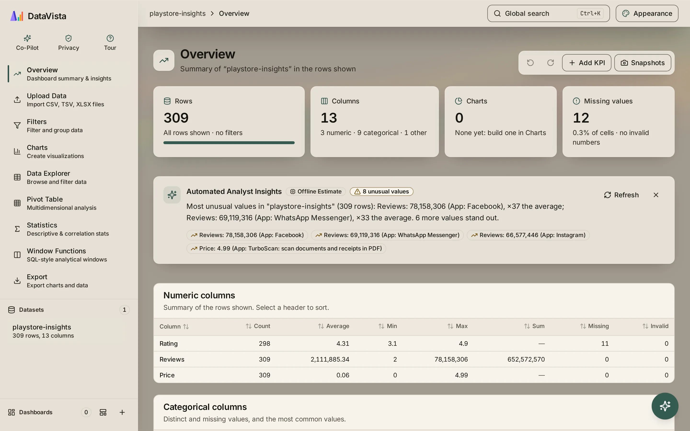
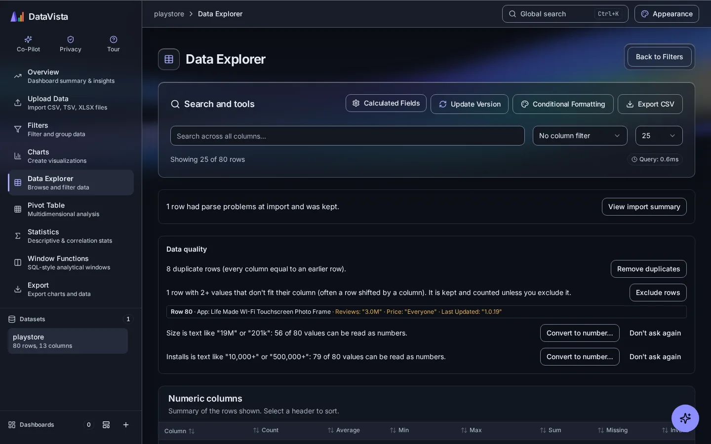
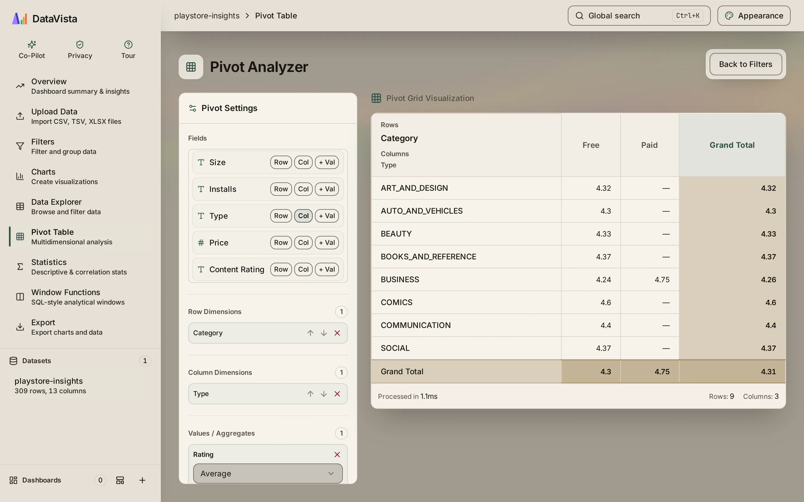
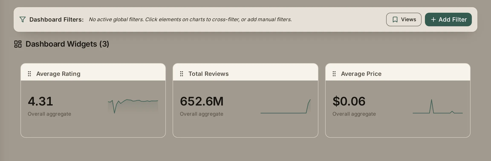

# DataVista

Browser-only analytics: import a CSV or Excel file, clean it, explore it, pivot it and chart it, with an optional AI copilot. No backend.

**Live demo:** https://vardaanbazaz.github.io/datavista/

[](https://github.com/vardaanbazaz/datavista/actions/workflows/deploy.yml)



## Features

- **Import** CSV, TSV and XLSX up to 100 MB, parsed in a Web Worker with Cancel.
- **Data quality:** duplicates, misaligned rows, missing-value codes and text-to-number fixes with a preview.
- **Explore** with search, calculated fields, filters, pivot tables, statistics and window functions.
- **Charts and dashboards:** many chart types, KPI cards, export to CSV, PNG, SVG and PDF.
- **AI copilot** (optional, your own key) answers questions by running queries in your browser.
- **Themes and accessibility:** 10 themes, high contrast, command palette, guided tour.

## Highlights

- 525,461-row Excel file imports in a Web Worker without freezing the tab (36 s total, longest main-thread block under 1 s; [method](docs/ARCHITECTURE.md)).
- Aggregations checked against pandas on 5 public datasets.
- Pivot on a 10,841-row file ready in 0.05 s on my laptop, with row virtualisation.
- 11 AI providers through one streaming client, no vendor SDKs (tested live with Gemini).
- 1,020 automated contrast checks, including text on translucent glass.

## Screenshots

|                                                                             |                                                                                 |
| --------------------------------------------------------------------------- | ------------------------------------------------------------------------------- |
|  |  |
| *Data-quality panel*                                                        | *Pivot table*                                                                   |



*KPI cards*

## Run locally

Requires Node 22.13+.

```sh
git clone https://github.com/vardaanbazaz/datavista.git && cd datavista
npm ci
npm run dev        # http://localhost:8080
```

**Tests:** `npm test` runs 1,746 unit tests (76 files); `npm run test:e2e` runs 80 e2e tests.

## Tech stack

React 18, TypeScript, Vite · Zustand · Dexie (IndexedDB) · D3 · Radix UI, Tailwind CSS · Vitest, Playwright · GitHub Actions and Pages.

## Privacy

Your files and every row stay in the browser (IndexedDB); without an AI provider nothing is sent anywhere.
With the copilot, the default "Queries" level sends column names, summary stats and query results, never rows; personal-data columns are masked.

## Links

- [Architecture and design notes](docs/ARCHITECTURE.md)
- [Design decisions log](decisions.md)
- [Licence](LICENSE): code is MIT. Test fixtures keep their original licences, see [tests/fixtures/README.md](tests/fixtures/README.md).
- [Dataset credits](docs/ARCHITECTURE.md#dataset-credits)
