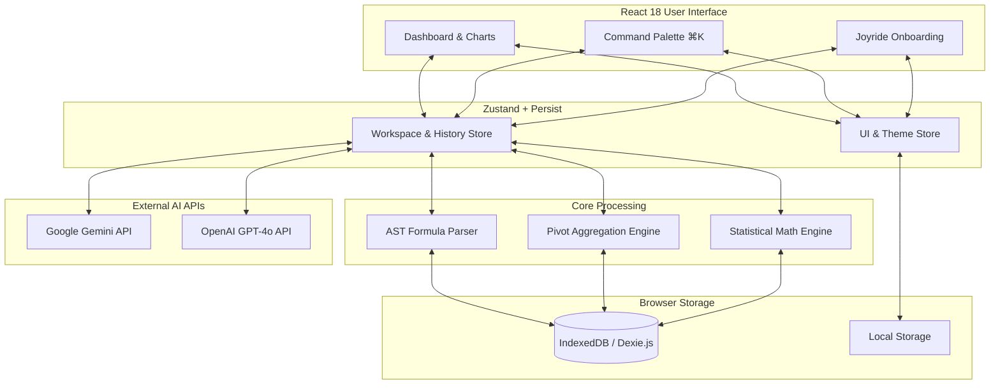

# DataVista 📊 

**DataVista** is an offline-first, browser-native Business Intelligence (BI) and analytics platform. 

### 📖 What is DataVista? (The Layman's Explanation)
Imagine taking the massive analytical power of enterprise tools like **Microsoft Power BI** or **Tableau** and cramming it entirely into your web browser. 

Normally, when you upload a spreadsheet to a data tool, your private data is sent to a remote server to be processed. **DataVista flips this model.** It uses your browser's internal storage and computing power to process, slice, and visualize multi-megabyte datasets locally. Your data never leaves your machine. 

Simply drag and drop a CSV or Excel file, and you instantly get access to interactive pivot tables, statistical analysis, complex formula parsing, and an AI Co-Pilot—all running at lightning speed directly on your device.

---

## 📸 Platform Gallery

*(Note: Replace these placeholder paths with actual screenshots of your application)*

| Overview Dashboard | Pivot Explorer |
| :---: | :---: |
|    *Real-time metrics and executive summaries* |    *Multidimensional data aggregation* |

| AI Co-Pilot | Advanced Charting |
| :---: | :---: |
|    *Natural language queries via Gemini/GPT-4o* |    *Over 8 interactive visualization types* |

---

## 🧠 System Architecture

DataVista bypasses traditional backend servers by utilizing a modular, engine-driven architecture completely housed within the client layer. 

