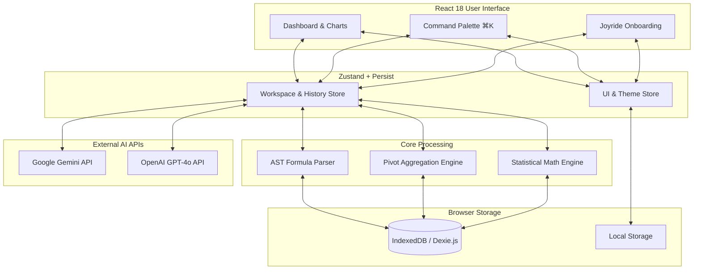
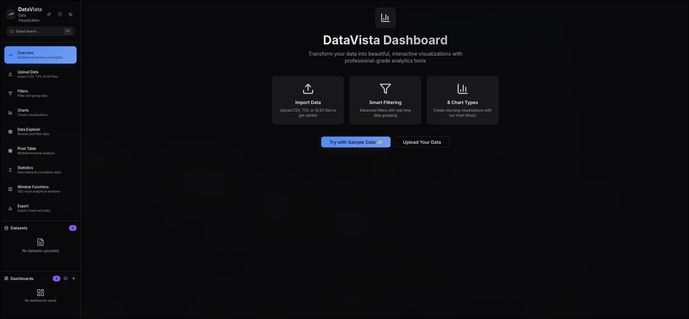
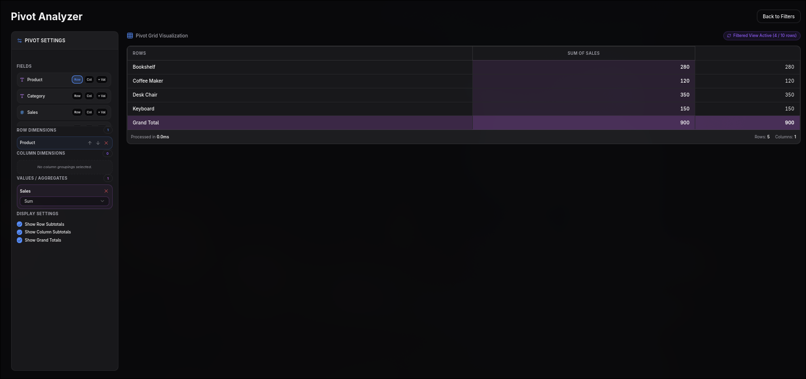
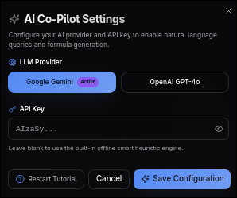
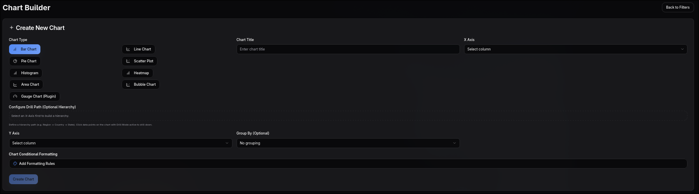

# DataVista 📊 


**DataVista** is an offline-first, browser-native Business Intelligence (BI) and analytics platform. 

---

### 📖 What is DataVista? (The Layman's Explanation)
Imagine taking the massive analytical power of enterprise tools like **Microsoft Power BI** or **Tableau** and cramming it entirely into your web browser. 

Normally, when you upload a spreadsheet to a data tool, your private data is sent to a remote server to be processed. **DataVista flips this model.** It uses your browser's internal storage and computing power to process, slice, and visualize multi-megabyte datasets locally. Your data never leaves your machine. 

Simply drag and drop a CSV or Excel file, and you instantly get access to interactive pivot tables, statistical analysis, complex formula parsing, and an AI Co-Pilot—all running at lightning speed directly on your device.

> **Privacy note:** everything above runs fully offline — except the AI
> Co-Pilot. If you add a Gemini/OpenAI API key and use natural-language
> queries or AI formula generation, sample values from your dataset's
> columns are sent to that provider to generate a response. Skip AI
> features and nothing ever leaves your device.

---

## 🚀 Core Technical Features

* **Offline-First Storage**: Utilizes IndexedDB (via Dexie) to locally store, version, and manage massive datasets without requiring a backend database.
* **Custom AST Formula Parser**: A recursive-descent parser that evaluates Excel-style calculated fields and window functions on the fly.
* **Unified Query & Pivot Engine**: A multidimensional framework-agnostic engine allowing users to group data by Rows, Columns, and Values with complex aggregations.
* **AI Co-Pilot Integration**: Connects directly to LLM APIs (Google Gemini, OpenAI GPT-4o) for natural language data querying and automated anomaly detection.
* **Enterprise UX**: Features a robust 14-step guided product tour (`react-joyride`), global command palette (`⌘K`), and strict Tailwind dark-mode constraints.

---

## 💻 Tech Stack

* **Framework**: React 18, Vite
* **Language**: Strict TypeScript
* **State Management**: Zustand (with local storage persistence)
* **Database / Local Persistence**: IndexedDB (Dexie.js)
* **Styling & UI**: Tailwind CSS, shadcn/ui, Framer Motion, Lucide Icons
* **DevOps & Quality**: GitHub Actions (CI/CD), Vitest (Unit Testing), Playwright (E2E), ESLint

---

## 🧠 System Architecture

DataVista bypasses traditional backend servers by utilizing a modular, engine-driven architecture completely housed within the client layer. 



---

## 📸 Platform Gallery


| Overview Dashboard | Pivot Explorer |
| :---: | :---: |
|  <br> *Real-time metrics and executive summaries* |  <br> *Multidimensional data aggregation* |

| AI Co-Pilot | Advanced Charting |
| :---: | :---: |
|  <br> *Natural language queries via Gemini/GPT-4o* |  <br> *Over 8 interactive visualization types* |

---

## 📖 How to Use DataVista

Follow these simple steps to explore and analyze your datasets with DataVista:

1. **Importing Datasets**: 
   - Click on **Upload Data** in the left sidebar or drag & drop CSV, TSV, or XLSX files (up to 100MB).
   - Alternatively, click **Try with Sample Data ✨** on the Overview Dashboard for an instant demo.
2. **Filtering & Narrowing Data**:
   - Go to **Filters** to construct multi-layered conditions (equals, contains, numeric range) and watch dataset counts update dynamically.
3. **Exploring Raw Data & Calculated Columns**:
   - Open **Data Explorer** to inspect records, apply conditional formatting, and write AST formula expressions.
   - Columns DataVista isn't confident about get a **Might be categorical** prompt — override the inferred type (numeric/categorical) with one click, or clear the override to revert to auto-detection.
4. **Building Visualizations & Charts**:
   - Navigate to **Charts** to create over 8 interactive visualization types (Bar, Line, Scatter, Pie, Heatmap, Area, Histogram, Bubble) with conditional formatting rules.
5. **Building Custom Dashboards**:
   - Open **Dashboards** to arrange multiple charts into a custom grid layout, save it as a reusable template, capture point-in-time snapshots, and drill through data points across the whole dashboard with a shared filter bar.
6. **Multidimensional Pivot Analysis**:
   - Select **Pivot Table** to aggregate fields across Rows, Columns, and Values with automated totals.
7. **Statistical Summaries & Outliers**:
   - Open **Statistics** to calculate mean, median, variance, standard deviation, correlation matrices, and IQR/Z-score outlier detection.
8. **Window Functions & Rankings**:
   - Use **Window Functions** to run rolling calculations, moving averages, cumulative sums, and row rankings (`ROW_NUMBER`, `RANK`, `DENSE_RANK`).
9. **AI Co-Pilot Assistance**:
   - Click the **AI Co-Pilot (Sparkles icon)** in the top header to configure your Gemini or GPT-4o API key — a status banner always shows whether AI is Active or running in Offline heuristic mode.
   - Natural-language queries are staged as a **preview** first; review the proposed filter/result before applying it or discarding it.
10. **Exporting Data & Reports**:
    - Visit **Export** to download processed datasets as CSVs, export individual charts as PNG or SVG images, or generate a full PDF report.
11. **Command Palette & Guided Tour**:
    - Press `Cmd+K` (or `Ctrl+K`) anytime to open the Global Search / Command Palette.
    - Click the `?` icon in the top header to restart the **14-step interactive guided tutorial**.

---

## 🛠️ Local Development

### Prerequisites
* **Node.js**: v18.x or higher
* **npm**: v9.x or higher

### Steps to Run Locally

```bash
# Clone the repository
git clone https://github.com/vardaanbazaz/datavista.git

# Navigate into the directory
cd datavista

# Install dependencies
npm install

# Start the Vite development server
npm run dev
```

Open `http://localhost:8080` in your browser to start using DataVista locally.

### Other Available Scripts
```bash
# Run unit test suite
npm run test

# Run TypeScript type check
npm run typecheck

# Build production bundle
npm run build
```

---

## 📄 License

This project is licensed under the MIT License - see the [LICENSE](LICENSE) file for details.
