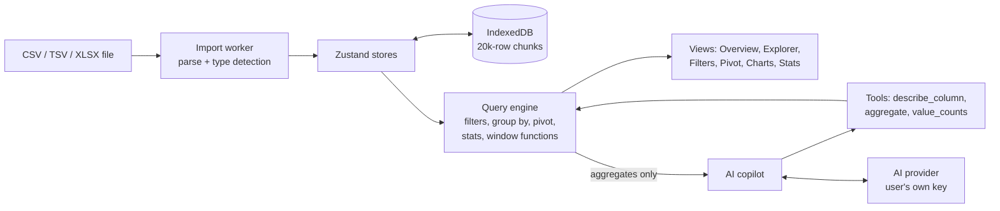

# DataVista: architecture and design notes

The detail behind the [README](../README.md). Design decisions and their reasons are logged in [decisions.md](../decisions.md); the call graph and entry points are in [flow.md](../flow.md). Architecture decision records: [ADR-001 zero-backend architecture](ADR-001-Zero-Backend-Architecture.md), [ADR-002 AST formula engine](ADR-002-AST-Formula-Engine.md), [ADR-003 query optimisation cache](ADR-003-Query-Optimization-Cache.md).

## How it works



- A file is checked for size and type, then parsed in a fresh Web Worker; the main thread only shows progress.
- The parsed dataset goes into Zustand stores and is saved to IndexedDB in chunks; only the dataset you reopen is read at startup.
- Every view reads through the same query engine and numeric rule, so a sum is the same number in the table, the pivot and the chart.
- The copilot gets a context built by one function that applies the privacy level and masking.
- When the model asks for data, the tool runs locally through the query engine and returns a small, bounded result.
- Requests go straight from the browser to the provider you configured; there is no DataVista server.

## Features in detail

- **Import:** CSV, TSV and XLSX (sheet picker, optional append of several sheets) up to 100 MB, parsed in a Web Worker with progress and Cancel.
- **Data quality:** parse problems shown before analysis, duplicate rows, misaligned rows, currency and "10,000+" / "19M" columns converted on request with a preview, missing-value codes, label variants, invalid dates kept as text and counted.
- **Explore:** data explorer with search and calculated fields (formula engine), filters, pivot tables, descriptive statistics and correlation, SQL-style window functions.
- **Charts and dashboards:** bar, line, area, bubble and more, date bucketing, Top N + Other; KPI cards with sparklines on the Overview dashboard; export to CSV, PNG, SVG and a PDF report.
- **AI copilot (optional, bring your own key):** asks questions of your data; the queries run in your browser and only their results go to the model.
- **Themes and accessibility:** 10 themes plus high contrast, text size, reduced motion, keyboard command palette (Ctrl/Cmd+K), guided tour.

## Engineering highlights, with where they were measured

Numbers come from [decisions.md](../decisions.md) and the local bench scripts.

- **Import in a Web Worker, with Cancel.** Parsing used to freeze the tab for 11–15 s (CSV) and 42–45 s (XLSX); after the move, no main-thread gap over 148 ms while reading and parsing the retail CSV and XLSX. A 525,461-row XLSX (`online_retail_II.xlsx`, one sheet) imports in 36.2 s from the sheet pick, longest main-thread block 0.96 s; the same rows as CSV in 11.3 s (production build, headless Chromium, 8-core laptop). Cancel terminates the worker, which frees everything it parsed.
- **IndexedDB, chunked.** Rows are stored apart from metadata in 20,000-row chunks (Dexie), and a save writes only what changed. Before, every rename or setting rewrote all datasets (3.9–5.6 s main-thread block at 1M rows). Reloading the 525k-row dataset from IndexedDB takes 3.1 s to the first KPI card (same bench as above).
- **One numeric rule, checked against pandas.** Every aggregation (stats, pivot, charts, KPIs, window functions, export) goes through one cell-to-number function, so blanks and junk are never counted as 0. Golden tests compare the engines with values computed independently by pandas on the IBM HR dataset (1,470 rows) and on four messy public datasets.
- **Time-zone-safe dates.** Calendar dates are built from their parts, never through `toISOString`. The 127 date tests run under Asia/Kolkata, America/New_York and UTC in CI, with a check that the zone really applied.
- **Bounded rendering.** On the Play Store file (10,841 rows), Filters built 39.8k DOM nodes and took 3.4 s to become interactive; Pivot took 2.4 s. With top-50 filter values plus search, and row virtualisation in Pivot: Filters 0.17 s (1.6k nodes), Pivot 0.05 s (Chrome trace, production build, headless).
- **Copilot tool loop.** The model can call `describe_column`, `aggregate` (group by, filters, up to 5 aggregations, at most 50 rows back) and `value_counts`; the queries run on the full dataset in the browser and only their results are sent back, up to 6 tool steps per answer. Raw rows are never sent at the default level; `get_rows` (at most 20 rows, masked) exists only at the "Sample rows" level.
- **11 providers, one client.** OpenAI, Anthropic, Gemini, OpenRouter, Groq, Mistral, DeepSeek, Together, Ollama, LM Studio and any OpenAI-compatible server, through one streaming `fetch` client for three API styles, no vendor SDKs.
- **Privacy levels and PII masking.** Four levels (see [Privacy](#privacy)); columns that look like emails, phone numbers or person names are masked at every level, can't be used to filter or group, and "Preview what will be sent" shows the exact request.
- **Contrast audit and axe.** 1,020 contrast checks (10 themes, each also in high contrast) on the colour actually drawn, including text on translucent glass; axe-core runs on every view in Light, Dark and Light high contrast in the e2e suite.
- **CI gates** (GitHub Actions, every push to main and every pull request): lint, typecheck, 1,746 unit tests (76 files), the date tests under 3 time zones, 80 Playwright e2e tests, and a smoke test of the production build (boots with zero console errors, imports a CSV through the worker). Pages deploys only the artifact that passed.

## Privacy

- **Stays in the browser:** your files, every row, calculated fields, dashboards and settings (IndexedDB and localStorage). "Clear all local data" deletes them.
- **Without an AI provider, nothing is sent anywhere.** The AI key is kept for the session unless you choose to remember it.
- **What the AI receives, per level** (you pick it in AI settings):

| Level | Sent to the provider |
|---|---|
| Schema | Column names and types |
| Summaries | Plus numeric stats (min, max, mean) and each text column's top values |
| Queries (default) | Plus the results of queries the copilot runs in your browser (totals, averages, counts, top values), never rows |
| Sample rows | Plus a seeded random sample of rows, and the copilot may look up a few rows |

Personal-data columns are masked at every level unless you tick "Send unmasked" for that column.

## Run and test

Requires Node 22.13+ (CI uses Node 24, see `.nvmrc`). `npm run dev` serves `http://localhost:8080`; `npm run build` then `npm run preview` serves the production build at `http://localhost:4173/datavista/`.

```sh
npm run lint
npm run typecheck
npm test                                              # unit + golden tests (Vitest)
npm run test:tz                                       # date tests under 3 time zones
npx playwright install chromium
npm run test:e2e                                      # e2e against the dev server
npm run build && npx playwright test --config playwright.prod.config.ts   # production smoke
```

The golden files are committed, so Python is only needed to regenerate them (`npm run golden:regen`, see [tests/fixtures/README.md](../tests/fixtures/README.md)).

README screenshots: `npm run build`, then `npx playwright test --config scripts/design/playwright.portfolio.config.ts` and `scripts/design/to-webp.sh` (writes `docs/images/*.webp`).

## Project structure

```
src/        app code: features/ (one folder per area), shared/ (engines, services, theme, UI), store/, pages/
tests/      e2e/ (Playwright), smoke/ (production build), fixtures/ (datasets + pandas golden files), bigfiles/ (local only)
scripts/    golden/ (pandas oracle), bench/, bigfiles/, design/ (screenshots), theme/, brand/, ai/
docs/       these notes, architecture decision records and README images
.github/    CI/CD workflow
```

## Dataset credits

Test fixtures are small subsets of public datasets (details and row lists in [tests/fixtures/README.md](../tests/fixtures/README.md)):

- IBM HR Analytics Employee Attrition (Kaggle `pavansubhasht`), Open Data Commons DbCL v1.0.
- Cafe sales, dirty data (Kaggle `ahmedmohamed2003`), CC BY-SA 4.0; the subset stays CC BY-SA 4.0.
- Google Play Store apps (Kaggle `lava18`), CC BY-SA 4.0 (the stricter of the two licences the source states); used for the messy subset, `playstore-insights.csv` and the README screenshots.
- Netflix movies and TV shows (Kaggle `shivamb`), CC0 1.0.
- Data science job postings on Glassdoor (Kaggle `rashikrahmanpritom`), CC0 1.0.

The large benchmark files (for example the 525k-row retail workbook) are used locally only and are not in the repository.
