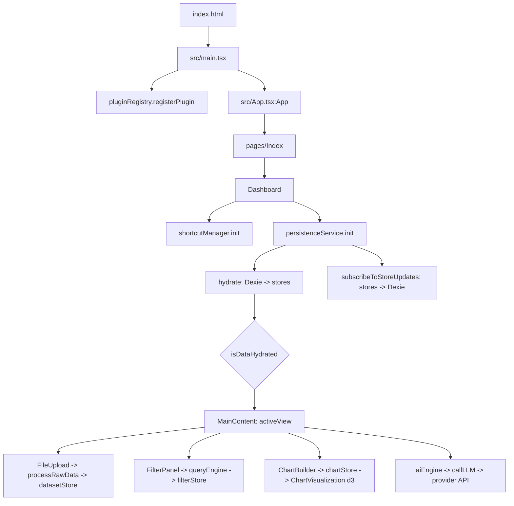

# Flow

## Entry points
- **Browser:** `index.html` loads `src/main.tsx` (in production: `assets/index-*.js`, plus `vendor-react`, `engine-core`, `vendor-viz`, `vendor-export`, `vendor-dates` chunks via modulepreload).
- **Routes** (`src/App.tsx`, `BrowserRouter basename={import.meta.env.BASE_URL}`):
  - `/` → `src/pages/Index.tsx` → `src/features/dashboard/components/Dashboard.tsx:Dashboard`
  - `*` → `src/pages/NotFound.tsx`
- **CLI scripts** (`package.json`): `dev` (vite), `build`, `preview`, `lint`, `typecheck` (`tsc --noEmit -p tsconfig.app.json`), `test` (vitest), `test:e2e` (playwright, dev server on :8080).
- **CI:** `.github/workflows/deploy.yml` on push to `main`: `npm ci` → lint → typecheck → test → build → install Playwright Chromium → production smoke gate (`playwright.prod.config.ts`: `vite preview` on :4173, `tests/smoke/prod-boot.spec.ts` asserts app shell renders with zero page/console errors) → upload `dist` → deploy to GitHub Pages.
- No backend, no background jobs.

## Startup order
1. Module evaluation: `vendor-react` (react, react-dom, zustand, react-router), then `engine-core` (`src/shared/services/*`, dexie, and the Zustand stores they import, e.g. `src/store/uiStore.ts` creates `useUiStore` at module load).
2. `src/main.tsx`: `pluginRegistry.registerPlugin(sampleGaugePlugin)` (`src/shared/services/pluginRegistry.ts`, `src/plugins/sampleGaugePlugin`).
3. `createRoot(#root).render(<ThemeProvider><App/></ThemeProvider>)`.
4. `src/App.tsx:App`: ErrorBoundary → QueryClientProvider → TooltipProvider → Toasters → Router.
5. `Dashboard` mount effects:
   - `src/features/workspace/services/shortcutManager.ts:init` (Cmd+K search, undo/redo, etc.)
   - `src/shared/services/persistenceService.ts:init` → `hydrate()` (reads Dexie tables from `src/shared/lib/db.ts` into stores, sets `uiStore.isDataHydrated`; 4s timeout fallback) and `subscribeToStoreUpdates()` (writes store changes back to IndexedDB).
6. Until `isDataHydrated` is true, `Dashboard` renders a loading state; then it renders `Sidebar` + `src/app/layout/MainContent.tsx:MainContent` for the `uiStore.activeView`.

## Main call graph
- `Dashboard.tsx:Dashboard` → views: `features/upload/components/FileUpload`, `features/datasets/components/DataTable`, `features/filters/components/FilterPanel`, `features/charts/components/ChartBuilder` / `ChartGrid`, `features/export/components/ExportPanel`, lazy `features/pivot/components/PivotExplorer`, `features/stats/components/StatsExplorer`, `features/window/components/WindowExplorer`.
- Upload: `FileUpload` → `papaparse` / `xlsx` → `src/shared/services/parsingService.ts:processRawData` → `src/store/datasetStore.ts:uploadDataset` → `persistenceService` subscriber → Dexie.
- Filters: `FilterPanel` → `src/shared/services/queryEngine.ts` → `src/store/filterStore.ts:setFiltersChange` → charts/table re-render.
- Charts: `ChartBuilder` → `src/store/chartStore.ts` → `features/charts/components/ChartVisualization.tsx` (d3).
- AI: `src/features/ai/aiEngine.ts` / `summaryEngine.ts` → `src/features/ai/llmService.ts:callLLM` → provider HTTPS API (Gemini default) using key from `uiStore.llmApiKey`.
- Dashboards: `src/features/dashboards/store/*` (dashboard, drill, snapshot, template, view stores), `features/dashboards/services/templateEngine.ts`, `filterManager.ts`.

## Build chunking note
`vite.config.ts` `manualChunks` must not create static cycles between chunks. Rollup's `\0commonjsHelpers.js` is pinned to `vendor-react` so `vendor-react` has no imports; see `decisions.md`.
