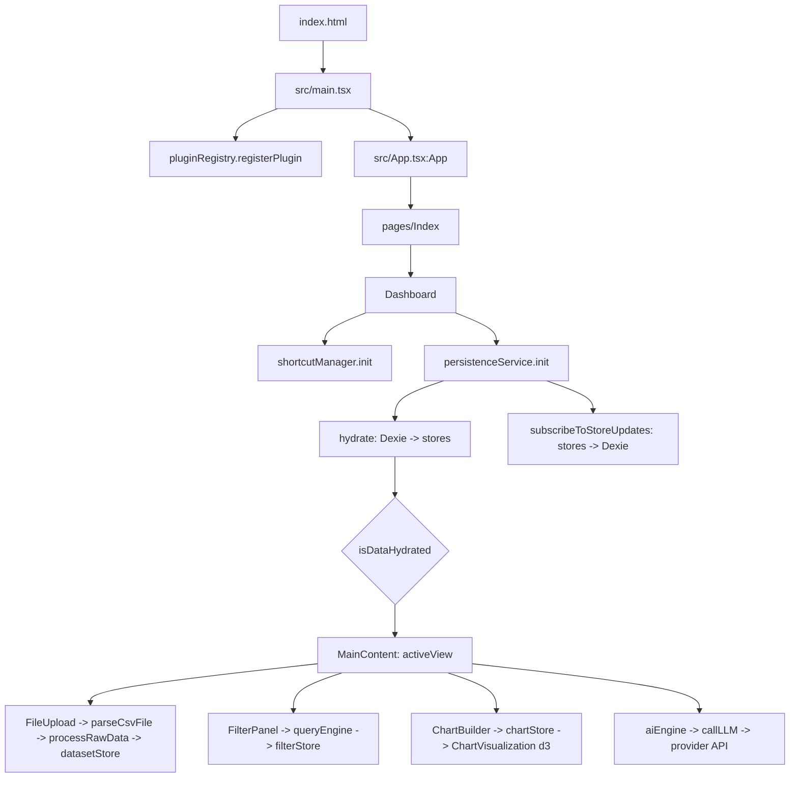

# Flow

## Entry points
- **Browser:** `index.html` loads `src/main.tsx` (in production: `assets/index-*.js`, plus `vendor-react`, `engine-core`, `vendor-viz`, `vendor-export`, `vendor-dates` chunks via modulepreload).
- **Routes** (`src/App.tsx`, `BrowserRouter basename={import.meta.env.BASE_URL}`):
  - `/` → `src/pages/Index.tsx` → `src/features/dashboard/components/Dashboard.tsx:Dashboard`
  - `*` → `src/pages/NotFound.tsx`
- **CLI scripts** (`package.json`): `dev` (vite), `build`, `preview`, `lint`, `typecheck` (`tsc --noEmit -p tsconfig.app.json`), `test` (vitest), `test:e2e` (playwright, dev server on :8080; specs in `tests/e2e/`, shared setup in `tests/e2e/helpers.ts`), `golden:regen` (`python3 scripts/golden/generate_hr_golden.py`: pandas oracle, reads `tests/fixtures/hr-attrition.csv`, writes `tests/fixtures/hr-attrition.golden.json`; needs `scripts/golden/requirements.txt`), `golden:regen-messy` (`python3 scripts/golden/generate_messy_golden.py`: reads `tests/fixtures/messy/*.csv`, writes `tests/fixtures/messy/messy.golden.json`).
- **CI:** `.github/workflows/deploy.yml` on push to `main`: `npm ci` → lint → typecheck → test (includes the golden suite, no Python needed) → install Playwright Chromium → e2e gate (`npm run test:e2e`) → build → production smoke gate (`playwright.prod.config.ts`: `vite preview` on :4173, `tests/smoke/prod-boot.spec.ts` asserts app shell renders with zero page/console errors) → upload `dist` → deploy to GitHub Pages.
- No backend, no background jobs.

## Startup order
1. Module evaluation: `vendor-react` (react, react-dom, zustand, react-router), then `engine-core` (`src/shared/services/*`, dexie, and the Zustand stores they import, e.g. `src/store/uiStore.ts` creates `useUiStore` at module load).
2. `src/main.tsx`: `pluginRegistry.registerPlugin(sampleGaugePlugin)` (`src/shared/services/pluginRegistry.ts`, `src/plugins/sampleGaugePlugin`).
3. `createRoot(#root).render(<ThemeProvider><App/></ThemeProvider>)`.
4. `src/App.tsx:App`: ErrorBoundary → QueryClientProvider → TooltipProvider → Toasters → Router.
5. `Dashboard` mount effects:
   - `src/features/workspace/services/shortcutManager.ts:init` (Cmd+K search, undo/redo, etc.)
   - `src/shared/services/persistenceService.ts:init` → `hydrate()` (reads Dexie tables from `src/shared/lib/db.ts` into stores, sets `uiStore.isDataHydrated`; 4s timeout fallback) and `subscribeToStoreUpdates()` (writes store changes back to IndexedDB).
6. Until `isDataHydrated` is true, `Dashboard` renders a loading state; then it renders `Sidebar` + `src/app/layout/MainContent.tsx:MainContent` for the `uiStore.activeView`.
   - `MainContent` scrolls `#main-content` and the window to the top whenever `uiStore.activeView` changes (any source). `Sidebar`'s mobile section menu (below `lg`) closes on the same `activeView` change, on Esc, on a pointerdown outside the sidebar, and on dataset/dashboard selection.

## Main call graph
- `Dashboard.tsx:Dashboard` → views: `features/upload/components/FileUpload`, `features/datasets/components/DataTable`, `features/filters/components/FilterPanel`, `features/charts/components/ChartBuilder` / `ChartGrid`, `features/export/components/ExportPanel`, lazy `features/pivot/components/PivotExplorer`, `features/stats/components/StatsExplorer`, `features/window/components/WindowExplorer`.
- Upload: `FileUpload` → CSV/TSV: `src/shared/services/csvParse.ts:parseCsvFile` (papaparse `header:false` → `recordsFromMatrix` → `parsingService.ts:normalizeHeaders`) / XLSX: `xlsx` `sheet_to_json` → `src/shared/services/parsingService.ts:processRawData` (`cleanValue` with `utils/numeric.ts:trimAscii`, `parseStrictNumber`) → `src/store/datasetStore.ts:uploadDataset` → `persistenceService` subscriber → Dexie. `DataTable`'s "replace data" input uses the same `parseCsvFile` → `processRawData`.
- Numbers: every aggregation converts cells with `src/shared/utils/numeric.ts:toNumberOrNull` and reduces with its `minMax`/`sum`/`mean`/`median`/`sampleStdDev`. `queryEngine.ts:aggregateRows` (+ `numericColumnSet(dataset)` for `count`) serves `computeAggregations`, `applyGroupingAndAggregations`, `kpi/kpiEngine.ts` (via `queryEngine.execute`), `pivot/hierarchyBuilder.ts:computeNodeValues` and `charts/lib/chartAggregation.ts:aggregateValues`. `stats/columnSummary.ts:summarizeNumericColumns` serves `DashboardSummary` (Overview), `DataTable` column stats and `exportUtils.ts` PDF summary. `stats/descriptive.ts`, `outliers.ts`, `correlation.ts`, `window/functions.ts`, `aggregations/core.ts`, `ai/anomalyDetector.ts`, `forecasting/engine.ts` call `toNumberOrNull` directly.
- Filters: `FilterPanel` → `src/shared/services/queryEngine.ts` → `src/store/filterStore.ts:setFiltersChange` → charts/table re-render.
- Charts: `ChartBuilder` → `src/store/chartStore.ts` → `features/charts/components/ChartGrid.tsx` / `features/dashboards/components/DashboardGrid.tsx` → `features/charts/components/ChartVisualization.tsx` (d3). `ChartVisualization` calls `src/features/charts/lib/chartAggregation.ts`: `aggregateValues` (per-x reduction, delegates to `queryEngine.ts:aggregateRows`), `chartYValueLabel` (Y axis / `<title>` tooltip / sr summary text) and `sortAxisKeys` (bar and heatmap key order). Both grids render `features/charts/components/ChartExpandButton.tsx`, which opens a Radix dialog mounting a second `ChartVisualization` with `fitHeight` (redrawn at the modal's measured size).
- Icon-only controls: wrapped in `src/shared/components/Hint.tsx:Hint` (Radix tooltip + aria-label; shortcut text via `src/shared/lib/platform.ts:formatShortcut`; adds the `hit-area` class from `src/index.css` for the 24px/44px pointer target; renders a `disabled` child as `aria-disabled` with `disabledReason` in the tooltip).
- View list: `src/store/viewTypes.ts:VIEW_TYPES` is the single source for `ViewType` and for `src/shared/utils/validators.ts:isValidUIState`'s `activeView` check (via `isViewType`).
- AI: `src/features/ai/aiEngine.ts` / `summaryEngine.ts` → `src/features/ai/llmService.ts:callLLM` → provider HTTPS API (Gemini default) using key from `uiStore.llmApiKey`.
- Dashboards: `src/features/dashboards/store/*` (dashboard, drill, snapshot, template, view stores), `features/dashboards/services/templateEngine.ts`, `filterManager.ts`.

## Golden numeric tests
`src/shared/services/__tests__/golden.hrAttrition.test.ts`: `csvParse.ts:parseCsvText` (same path as `FileUpload`) → `parsingService.ts:processRawData` → `queryEngine.execute` (group-by Age / Department / JobRole), `pivot/engine.ts:pivotEngine.execute` (Department > JobRole; Department × Gender with totals), `stats/engine.ts:statsEngine.calculateDatasetStats` (descriptive, IQR/z-score outliers, Pearson), `window/engine.ts:windowEngine.execute` (ROW_NUMBER/RANK/DENSE_RANK/RUNNING_TOTAL) → compared with `tests/fixtures/hr-attrition.golden.json`. `src/features/charts/lib/__tests__/chartAggregation.test.ts` checks the chart's own reduction (`aggregateValues`) against the same file. `tests/e2e/chart-labels.spec.ts` uploads the CSV in the browser and checks the rendered Age × Education bar chart (label, tick order, Age 35 tooltip), inline and in the Expand modal.

`src/shared/services/__tests__/golden.messy.test.ts`: each `tests/fixtures/messy/*.csv` → `parseCsvText` → `processRawData` → `statsEngine.calculateDatasetStats` (full and filtered path), `queryEngine.execute` (the KPI query, and a group-by), chart `aggregateValues`, `summarizeNumericColumns` (Overview) → compared with each other and with `tests/fixtures/messy/messy.golden.json`.

## Build chunking note
`vite.config.ts` `manualChunks` must not create static cycles between chunks. Rollup's `\0commonjsHelpers.js` is pinned to `vendor-react` so `vendor-react` has no imports; see `decisions.md`.
