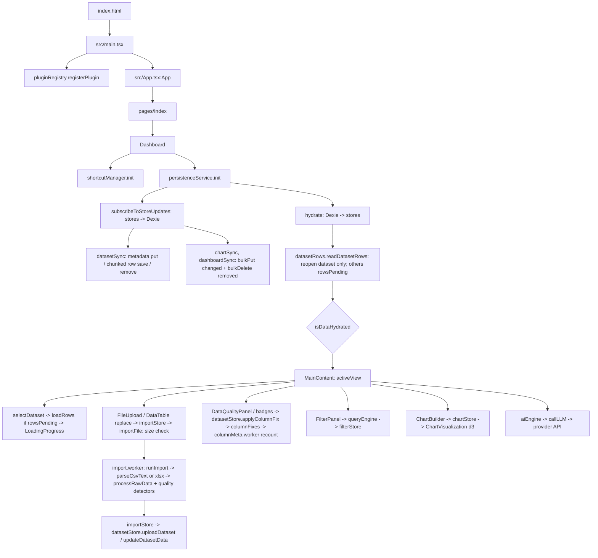

# Flow

## Entry points
- **Browser:** `index.html` first runs the inline theme boot script (injected at build/dev time by `vite.config.ts:themeBootPlugin` from `src/shared/theme/boot.ts:bootScript` → `bootTheme(window, …, resolveThemeId, readStoredPrefs, applyAttributes)`: reads `datavista-ui-storage`, resolves Automatic, sets `data-theme`, `.light`/`.dark`, `data-text-size`, `data-contrast`, `data-motion`, `data-transparency`, `data-animation` on `<html>` before the first paint), then loads `src/main.tsx` (in production: `assets/index-*.js`, plus `vendor-react`, `engine-core`, `vendor-viz`, `vendor-export`, `vendor-dates` chunks via modulepreload).
- **Column recount worker:** `src/shared/services/columnMeta/columnMeta.worker.ts`, started by `columnMeta/client.ts:computeColumnMetadata` after a column fix or duplicate removal, one per recount, terminated after the last column.
- **Import worker:** `src/features/upload/worker/import.worker.ts`, started by `src/features/upload/lib/importClient.ts:createImportWorker` (`new Worker(new URL(...), { type: "module" })`) once per import and terminated when it ends or is cancelled. In production it is its own IIFE bundle, `assets/import.worker-*.js`.
- **Routes** (`src/App.tsx`, `BrowserRouter basename={import.meta.env.BASE_URL}`):
  - `/` → `src/pages/Index.tsx` → `src/features/dashboard/components/Dashboard.tsx:Dashboard`
  - `*` → `src/pages/NotFound.tsx`
- **CLI scripts** (`package.json`): `dev` (vite), `build`, `preview`, `lint`, `typecheck` (`tsc --noEmit -p tsconfig.app.json`), `test` (vitest), `test:e2e` (playwright, dev server on :8080; specs in `tests/e2e/`, shared setup in `tests/e2e/helpers.ts`; `tests/e2e/a11y.spec.ts` runs axe-core on every view (empty and with the HR fixture) and the main dialogs in Light, Dark and Light high contrast (three independent tests, one app load and one HR import each, themes switched in the page through the Appearance panel; two workers in CI); `tests/e2e/glass-text.spec.ts` fails on text drawn on glass in a colour the contrast audit does not cover (Light, Clay, Dusk); `tests/e2e/onboarding.spec.ts` covers the first-run setup and runs the whole tour in sidebar order (desktop: popover beside the sidebar item; 390 px: bottom sheet; never over its target, always inside the viewport); `tests/e2e/overview.spec.ts` opens the KPI builder from the Overview and checks the bento tiles; `tests/e2e/appearance.spec.ts` checks Appearance applies, survives a reload, high contrast forces glass off, Automatic follows the device live and switches on a schedule), `theme:css` (`vite-node scripts/theme/generate-theme-css.ts`: `src/shared/theme/themes.ts` → `themeCss.ts:renderThemeCss` → `src/shared/theme/themes.generated.css`; `tokens.generated.test.ts` fails when it is stale), `brand:assets` (`vite-node scripts/brand/generate-brand-assets.ts`: `src/shared/brand/logoGeometry.ts:logoSvg` (the active option of `logoVariants.ts`) → `public/favicon.svg`, `logo.svg`, `favicon.ico` (Playwright Chromium + ImageMagick), `apple-touch-icon.png`, `og-image.png`), `golden:regen` (`python3 scripts/golden/generate_hr_golden.py`: pandas oracle, reads `tests/fixtures/hr-attrition.csv`, writes `tests/fixtures/hr-attrition.golden.json`; needs `scripts/golden/requirements.txt`), `golden:regen-messy` (`python3 scripts/golden/generate_messy_golden.py`: reads `tests/fixtures/messy/*.csv`, writes `tests/fixtures/messy/messy.golden.json`, numeric stats and date stats), `test:tz` (vitest on `*.tz.test.ts` + `golden.messy` under `TZ=Asia/Kolkata`, `America/New_York`, `UTC`; stops at the first failing zone), local startup/save bench (not an npm script, not in CI: `npm run build`, then `npx playwright test --config scripts/bench/playwright.startup.config.ts [-g small|"1M inactive"|"1M active"|"select 1M"|"toggle 300k"|"toggle 600k"]`; `vite preview` on :4173, real Chromium IndexedDB; `scripts/bench/startup/startup.spec.ts` imports a 50-row CSV, clones its stored record with generated row chunks, reloads and reads the app's `dv:*` User Timing measures plus the longest `longtask`; writes `bench-results/<label>-<scenario>.json`, git-ignored; `-g "first load"` runs `scripts/bench/startup/first-load.spec.ts`: cold-cache JS/CSS/font bytes and time to the sidebar, unthrottled and Slow 4G, `BENCH_RUNS` runs each → `bench-results/<label>-first-load.json`), design screenshots (not an npm script, not in CI: `npx playwright test --config scripts/design/playwright.design.config.ts`, dev server on :8080, `scripts/design/batch7-a.spec.ts` → `docs/design/batch7-a/*.png`, `batch7-b.spec.ts` → `docs/design/batch7-b/*.png`, `batch7-c.spec.ts` (fix-ups: tour on Charts desktop/390, XLSX read + sheet picker with `test-data-local/online_retail_II.xlsx`, Play Store summary and Overview in Light/Dusk) → `docs/design/batch7-c/*.png`, `readme.spec.ts` → `docs/screenshots/*-{light,dark}.png`; `scripts/design/axe-survey.spec.ts`: the full local axe survey, every theme × normal/high contrast × every view (empty and with HR) + Appearance, setup and command palette, fails on any violation (`AXE_THEMES=…`, `AXE_REPORT_ONLY=1`); logo options sheet: `npx vite-node scripts/brand/logo-options.ts` → `docs/design/batch7-b/logo-options.png`), glass/animation bench (local only: `npm run build`, then `npx playwright test --config scripts/bench/playwright.startup.config.ts -g glass` → `scripts/bench/startup/glass-perf.spec.ts`: 1M-row grid scroll, four-chart page scroll, idle CPU, each with glass + animation on and off; `BENCH_HEADED=1` / `BENCH_GPU=1`, `BENCH_DIST=<dir>` serves another build), `test:bigfiles` (local only, not in CI: `scripts/bigfiles/run.mjs` runs `tests/bigfiles/bigfiles.spec.ts` with `playwright.bigfiles.config.ts` once per file found in `test-data-local/`, one at a time, each with its own dev server; writes `test-results/bigfiles/<file>.json`).
- **CI:** `.github/workflows/deploy.yml` on push to `main`, four jobs; every job's Node comes from `.nvmrc` (24). `checks` (`npm ci` → lint → typecheck → test (includes the golden suite, no Python needed) → time zone gate (`npm run test:tz`)), `e2e` (`npm ci` → install Playwright Chromium → `npm run test:e2e`) and `build` (`npm ci` → build → install Playwright Chromium → production smoke gate (`playwright.prod.config.ts`: `vite preview` on :4173, `tests/smoke/prod-boot.spec.ts` asserts app shell renders with zero page/console errors, then imports a small CSV through the import worker) → upload `dist` as the Pages artifact) run in parallel; then `deploy` (`needs: [checks, e2e, build]`) only runs `actions/deploy-pages` on that artifact (no checkout, no rebuild).
- No backend, no background jobs.

## Startup order
1. Module evaluation: `vendor-react` (react, react-dom, zustand, react-router), then `engine-core` (`src/shared/services/*`, dexie, and the Zustand stores they import, e.g. `src/store/uiStore.ts` creates `useUiStore` at module load).
2. `src/main.tsx`: `pluginRegistry.registerPlugin(sampleGaugePlugin)` (`src/shared/services/pluginRegistry.ts`, `src/plugins/sampleGaugePlugin`).
3. `src/main.tsx` → `src/shared/theme/displayPrefs.ts:applyDisplayPrefs(uiStore.themeSetting, uiStore.appearance)` before the first render (the store has already read localStorage; zustand persist v3, `migrate`/`merge` go through `boot.ts:readStoredPrefs`, which also reads v1 `theme`/`readingComfort` and drops a v1/v2 `backgroundAnimation: true`, the old default) → `boot.ts:resolveThemeId` + `applyAttributes` (the same functions as the inline script) → `uiStore.resolvedTheme`. `src/index.css` imports `themes.generated.css` (one `:root[data-theme]` block per theme + its high-contrast block) and reads the attributes (root font size, glass fallbacks, ribbon motion).
4. `createRoot(#root).render(<ThemeProvider><App/></ThemeProvider>)`. `src/app/providers/ThemeProvider.tsx:ThemeProvider` re-applies on every `themeSetting`/`appearance` change and, for Automatic, on the device's `prefers-color-scheme` change ("Follow device") or a timer to the next day/night start (`displayPrefs.ts:msUntilNextSwitch`, "Schedule"), and on `visibilitychange` back to visible.
5. `src/App.tsx:App`: ErrorBoundary → `src/app/providers/MotionPreference.tsx:MotionPreference` (framer `MotionConfig reducedMotion` from `appearance.motion`) → TooltipProvider → Toasters → Router.
6. `Dashboard` mount effects:
   - `src/features/workspace/services/shortcutManager.ts:init` (Cmd+K search, undo/redo, etc.)
   - `src/shared/services/persistenceService.ts:init` → `hydrate()` (reads Dexie tables from `src/shared/lib/db.ts` into stores; rows only for the dataset the session reopens on, see Persistence → Load; reports each step in `uiStore.startupStatus`; sets `uiStore.isDataHydrated`; 4s timeout fallback), `subscribeToStoreUpdates()` (writes store changes back to IndexedDB) and `flushOnPageHide()` (`pagehide` / `visibilitychange` hidden → `flush()`). Opening the database runs `db.ts:upgradeToV2` once for a v1 database `upgradeToV3` (dataset `order`) and `upgradeToV4` (removed duplicate rows out of metadata into `removedRows`) (see Persistence below).
7. Shell: `Dashboard` renders `src/shared/components/surface/AuroraRibbon.tsx:AuroraRibbon` (absolute, top of the page, behind sidebar and view; `hero` size on the empty Overview and Upload; still by default; with Background animation on, `data-paused="false"` attaches the CSS `aurora-sway` transform animation (index.css) while it is on screen (IntersectionObserver), the tab is visible and motion / contrast allow it), the glass `Sidebar` (sticky; `src/shared/brand/Logo.tsx`) and `MainContent` (sticky glass top header on large screens: breadcrumb from `store/viewTypes.ts:VIEW_LABELS`, Global search (`data-tour="global-search"`), Appearance (`data-tour="appearance"`, `data-testid="open-appearance"`)).
8. Until `isDataHydrated` is true, `Dashboard` renders `src/shared/components/LoadingSpinner.tsx:LoadingProgress` with `uiStore.startupStatus` (step text, e.g. "Loading rows of “sales”", and rows read / total with a bar when known); then it renders `Sidebar` + `src/app/layout/MainContent.tsx:MainContent` for the `uiStore.activeView`.
   - First visit: a `Dashboard` effect (once `isDataHydrated`) → `SetupFlow.tsx:shouldOfferSetup` (no `hasCompletedSetup`, no `hasSeenTour`, no `datavista-visited`, no datasets) → `uiStore.setIsSetupOpen(true)` → `src/features/settings/components/SetupFlow.tsx:SetupFlow` (Look → Effects & comfort → AI key → Take the tour / Start with sample data; controls from `appearanceControls.tsx`, shared with `AppearancePanel`; writes `uiStore.setThemeSetting` / `setAppearance` / `setLlmApiKey` live; closing or finishing → `uiStore.completeSetup` (sets `hasCompletedSetup` and `datavista-visited`)). "Start with sample data" → `src/features/datasets/sampleData.ts:loadSampleDataset` (also behind the Overview / Upload "Try with sample data" buttons). The tour never starts by itself.
   - `MainContent` scrolls `#main-content` and the window to the top whenever `uiStore.activeView` changes (any source). `Sidebar`'s mobile section menu (below `lg`) closes on the same `activeView` change, on Esc, on a pointerdown outside the sidebar, and on dataset/dashboard selection.

## Main call graph
- `Dashboard.tsx:Dashboard` → views: `features/upload/components/FileUpload`, `features/datasets/components/DataTable`, `features/filters/components/FilterPanel`, `features/charts/components/ChartBuilder` / `ChartGrid`, `features/export/components/ExportPanel`, lazy `features/pivot/components/PivotExplorer`, `features/stats/components/StatsExplorer`, `features/window/components/WindowExplorer`.
- Import (every file input): `FileUpload` (`<input type="file">` and drop zone) → `src/store/importStore.ts:importForUpload`; `DataTable` "replace data" `<input type="file">` → `importStore.ts:importForReplace`. Both → `importStore.ts:run` → `src/features/upload/lib/importClient.ts:importFile` → `lib/importLimits.ts:checkImportFile` (format + `MAX_IMPORT_BYTES`, before any read; rejection = toast, no dialog; large-file warning toast) → worker `src/features/upload/worker/import.worker.ts` → `lib/importCore.ts:runImport`:
  - CSV/TSV: `readText` (4 MB slices, "reading" %) → `src/shared/services/csvParse.ts:parseCsvText` with `chunkSize` (Papa string chunks → `CsvRecordBuilder.addChunk` → `parsingService.ts:normalizeHeaders`; "parsing" %) → `summarizeIssues` → if rows have problems: `dataQuality.ts:findDuplicateRows` (count for the summary), worker posts `review`, `ImportDialog` shows the summary, the answer (keep / exclude / cancel) comes back via `importStore.answerReview`.
  - XLSX/XLS (`importCore.ts:xlsxRecords`, progress text from `XLSX_DETAIL`, sent as `progress.detail` → `importStore.detail` → `ImportDialog` `ProgressView`): `readBytes` → `XLSX.read(bookSheets)` (sheet names only) → more than one sheet: `previewSheets` (`readPreview`: `XLSX.read(sheetRows: 3)`, headers via `sheetKeys`, row count from `!fullref`; ambiguous sheets read again with 1,001 rows) → worker posts `sheets`, `ImportDialog` `SheetPicker` answers via `importStore.answerSheet` (one sheet, or append with `Source sheet`) → `src/features/upload/lib/xlsxDates.ts:readWorkbookWithCalendarDates(bytes, chosenSheets)` (parses only the chosen sheets; date-formatted serials → calendar strings, 1904 system aware; the date format is dropped from every date-formatted cell so SheetJS 0.20's `sheet_to_json` never turns it into a JS Date) → `planSheet` per chosen sheet → `sheetRecords` (`sheet_to_json` in 20,000-row blocks, "parsing" %). Unknown progress shows `ui/progress.tsx` `indeterminate` (`.progress-indeterminate` in index.css).
  - Then `src/shared/services/parsingService.ts:processRawData` (per column `dataQuality.ts:detectImportConversion` → currency / thousands fix via `columnFixTransforms.ts:transformColumn`, originals into `fixSourceValues`, `metadata.columnFixes`, warnings into `metadata.quality`; `dataQuality.ts:findDuplicateRows` on the raw records → `metadata.quality.duplicateIndices`; `onProgress` → "analysing" %; `importIssues` → `metadata.importIssues`, `parsingStatistics.errorCount`; `cleanValue` (blanks and `utils/numeric.ts:MISSING_TEXT_TOKENS` — "", n/a, nan, null, none, #n/a, undefined — become null in every column) with `utils/numeric.ts:trimAscii`, `parseStrictNumber`; `inferColumn` (then `hasLetterCodes`: an ID-named column (`utils/columnRoles.ts:isIdName`) with letter codes → categorical) → `utils/dates.ts:analyzeDateColumn` (per-column day/month order, default passed in from the main thread's `localeDayFirst`) → `parseDateValue` for date cells; `generateDatasetMetadata` sets `invalidDateCount`, `dayFirst`, `detectedFormat`, `dateParserVersion`, and per column `quality` via `dataQuality.ts:columnQuality` (invalid values + samples, top values, label variants, sentinel, suffix candidate); keeps `dataset.dateSourceValues` for numeric D/M columns) → worker posts `done` (structured clone) → `importClient` terminates the worker.
  - Upload: `importStore` sets stage "saving" (Cancel disabled) → `src/store/datasetStore.ts:uploadDataset` (sets `order`; success toast with duplicate count and converted columns) → `persistenceService` subscriber → Dexie. Replace: `DataTable` opens `DatasetUpdateModal` → `datasetStore.updateDatasetData` (with the new `dateSourceValues` and `fixSourceValues`).
  - Cancel: `ImportDialog` → `importStore.cancel` → `ImportJob.cancel` → `worker.terminate()`; `datasetStore` is never touched.
  - Progress, sheet picker and parse summary: `src/features/upload/components/ImportDialog.tsx:ImportDialog` (mounted once in `Dashboard`, reads `importStore`). Reopen later: `DataTable` notice → `ImportDialog.tsx:ImportIssuesDialog` (reads `metadata.importIssues`).
- Dates: every reader of stored date cells goes through `src/shared/utils/dates.ts` (calendar parts, no time zone): `queryEngine.ts` (`periodKey` for group-by periods, `calendarDay`/`rangeBoundDay` for `applyFilters` date ranges, `toComparableNumber` + whole-day end bound for `between`/`equals` conditions from `GlobalFilterBar`, `compareCells` in `applySorting`), `window/partitioner.ts:sortPartitionItems` (`compareCells`), `kpi/kpiEngine.ts` trend (via `queryEngine.execute` group-by period), `charts/lib/chartAggregation.ts` (`sortAxisKeys`, `lineSeries` → `dateKeyMs`), `ChartVisualization` (d3 `scaleUtc`/`utcFormat`), `forecasting/engine.ts` (`stepDateKey`), `formula/library/date.ts`, `formulaEngine.ts` (calculated column typing via `isStoredDate`). Day/month toggle: `DataTable` date badge popover → `datasetStore.setDateDayFirst` → `parsingService.ts:reparseDateColumn` (via `applyActiveDatasetUpdate`). Old datasets: `parsingService.ts:needsDateReimportNotice` → `DataTable` notice → `datasetStore.dismissDateReimportNotice`.
- Numbers: every aggregation converts cells with `src/shared/utils/numeric.ts:toNumberOrNull` and reduces with its `minMax`/`sum`/`mean`/`median`/`sampleStdDev`. `queryEngine.ts:aggregateRows` (+ `numericColumnSet(dataset)` for `count`) serves `computeAggregations`, `applyGroupingAndAggregations`, `kpi/kpiEngine.ts` (via `queryEngine.execute`), `pivot/hierarchyBuilder.ts:computeNodeValues` and `charts/lib/chartAggregation.ts:aggregateValues`. `stats/columnSummary.ts:summarizeNumericColumns` serves `DashboardSummary` (Overview), `DataTable` column stats and `exportUtils.ts` PDF summary. `stats/descriptive.ts`, `outliers.ts`, `correlation.ts`, `window/functions.ts`, `aggregations/core.ts`, `ai/anomalyDetector.ts`, `forecasting/engine.ts` call `toNumberOrNull` directly.
- Persistence (`src/shared/services/persistenceService.ts`, schema in `src/shared/lib/db.ts`):
  - Tables (Dexie v4): `datasets` (`StoredDataset`: a dataset without `data`/`dateSourceValues`/`fixSourceValues`, plus `rowCount`, `chunkCount`, `dateSourceColumns`, `fixSourceColumns`, `order`), `datasetRows` (key `[datasetId+index]`, `ROW_CHUNK_SIZE` rows per record plus the same slice of `dateSourceValues` and `fixSourceValues`), `removedRows` (key `datasetId`: rows taken out by "Remove duplicates", written by the row save only when `Dataset.removedDuplicates` changed), `charts` (no rows), `filters`, `uiState`, `dashboards`.
  - Load: `hydrate` → filters, `uiState` prefs, dashboards → reopen id (the active dashboard's `datasetId`, else `activeDatasetId`) → `loadDatasets(reopenId)` (`db.datasets.toArray` sorted by `db.ts:compareDatasetOrder`; the reopen dataset → `src/shared/services/datasetRows.ts:readDatasetRows` (one read transaction, one `datasetRows.get` per chunk plus `removedRows.get` when `metadata.removedDuplicateCount` > 0, progress into `startupStatus`) → `db.ts:fromStoredDataset` → `datasetRows.ts:prepareLoadedDataset` (`backfillAllIntegerValues` → `formulaEngine.evaluateCalculatedFields` → `windowEngine.evaluate`); every other dataset → `db.ts:toPendingDataset` (`data: []`, `rowsPending: {rowCount, chunkCount, dateSourceColumns}`)) → `isValidDataset` → charts → stores; then `datasetSync.seed`, `chartSync.seed`, `dashboardSync.seed`, `seedBaselines`. Timing marks (`src/shared/lib/perfMarks.ts`): `dv:startup:open-db`, `read-metadata`, `read-rows`, `evaluate`, `hydrated`, `first-render` (set in `Dashboard`), `render`.
  - Unloaded dataset selected: `Sidebar` / `CommandPalette` → `datasetStore.selectDataset` → `datasetStore.loadRows(id)` (one load per id; `rowsLoading` {name, loadedRows, totalRows} drives `MainContent`'s `LoadingProgress` in place of the view) → `datasetRows.ts:loadPendingRows` → replaces the placeholder in `datasets` (keeping a rename made meanwhile) → activates it only if it is still the last selection. `dashboardStore.loadDashboard`, `dashboardStore.ts:restoreExternalContext` (undo/redo) and `snapshotStore.restoreSnapshot` call `loadRows` first and re-run themselves when the rows are in; `deleteDataset` moves to the next dataset through `selectDataset`. Row counts of unloaded datasets (`Sidebar`, `searchEngine`) come from `datasetRows.ts:datasetRowCount`.
  - Datasets: `useDatasetStore.subscribe((state, prev))` → `createDatasetSync().onChange(next, prev)`: removed id → `remove` (metadata + chunk range, one transaction); `rowsRevision` differs from disk/queued → dirty, `ROW_SAVE_DELAY_MS` (500 ms) debounce → `saveRows` (one rw transaction: `datasetRows.put(toRowChunk(d, i))` per chunk, delete chunks past the end, `datasets.put(toStoredDataset(d))`; never for a `rowsPending` dataset); a placeholder replaced by its loaded rows at the same `rowsRevision` → nothing; otherwise → `saveMetadata` (`datasets.put`, skipped while a row save is waiting; `toStoredDataset` writes a `rowsPending` dataset's stored counts, not `data.length`). All dataset jobs run on one queue. `rowsRevision` is bumped by `datasetStore.ts:withNewRows` in `updateDatasetData` and `applyActiveDatasetUpdate` (calculated/window add/delete, `setDateDayFirst`), not by `setColumnTypeOverride` (`changesRows: false`), rename, delete or `dismissDateReimportNotice`.
  - Charts / dashboards: `createRecordSync` (300 ms debounce) → one transaction with `bulkDelete` (ids gone since the last write) + `bulkPut` (objects that changed).
  - Active dataset change → `onActiveDatasetChange` (uiState `activeDatasetId`, dashboard de-select, `restorePivotConfig`, saved filters → `queryEngine.execute`).
  - Failures → `reportSyncFailure` (toast; `QuotaExceededError` gets the "Storage full: changes not saved" message). `whenIdle()` flushes and waits for every write (tests).
- Data quality (Data view): `DataTable` → `features/datasets/components/DataQualityPanel.tsx:DataQualityPanel` (duplicates, sentinel prompts, label-variant merges, "Convert to number…" dialog with `columnFixes.ts:previewNumberConversion`, currency/grouping warnings; `datasetStore.ensureColumnQuality` backfills `quality` for old datasets through the recount worker) and per header `ColumnQualityBadges` (fix badges with Undo, labels from `features/datasets/lib/fixLabel.ts`; invalid-value popover). Actions: `datasetStore.applyColumnFix` / `undoColumnFix` → `columnFixes.ts:addColumnFix` / `removeColumnFix` (`replayColumn` from `fixSourceValues`, `deferMeta`); `removeDuplicates` / `restoreDuplicates` → `columnFixes.ts:removeDuplicateRows` / `restoreDuplicateRows`; all through `applyActiveDatasetUpdate` (rowsRevision bump → one debounced row save), then `recountColumns` → `columnMeta/client.ts:computeColumnMetadata` (worker) → `columnFixes.ts:mergeColumnMeta`. `dismissSuggestion` → metadata only. Cells of a currency column render with `numberFormats.ts:formatCurrency`.
- Column types: every view and engine reads `src/shared/utils/columnType.ts:getEffectiveColumnType` / `columnsOfType` (override, else `columnTypes` incl. fix conversions).
- Overview: `DashboardSummary` → `PageHeader` (actions on a glass toolbar: undo/redo, "Add KPI" (`overview-add-kpi`), Snapshots, Save as Template with a dashboard open), Bento of glass tiles in one row on large screens (rows + filters, columns, charts, missing values), `ExecutiveSummaryPanel`, then solid `DataPanel`s → `stats/columnSummary.ts:summarizeNumericColumns` and `summarizeCategoricalColumns` (metadata `quality.topValues` when all rows are shown, else counted); shares via `utils/percent.ts:formatShare` / `formatPercent` ("<0.1%", ">99.9%"; also Stats "Missing Records").
- KPI cards: Overview "Add KPI" → `kpi/components/KPIBuilder.tsx` → `DashboardSummary.saveKpi`: with a dashboard open → `dashboardStore.addKpiCard` / `updateKpiCard`; without one → `dashboardStore.createDashboard("<dataset> KPIs", …)` then `addKpiCard` on the new active dashboard. Cards render in `dashboards/components/DashboardGrid.tsx` (edit from a card → the same builder).
- Appearance: `MainContent` header button (`open-appearance`) or the phone menu's Appearance tool (`open-appearance-mobile`) → `uiStore.setIsAppearanceOpen` → `src/features/settings/components/AppearancePanel.tsx` (mounted in `Dashboard`; controls from `appearanceControls.tsx`; swatches drawn from `themes.ts` tokens; forced-off reasons from `displayPrefs.ts:transparencyBlockedReason` / `animationBlockedReason`; "Take the tour" → `uiStore.resetTour`; "Run setup again" → `uiStore.setIsSetupOpen(true)`) → `uiStore.setThemeSetting` / `setAppearance` → `ThemeProvider` → `displayPrefs.ts:applyDisplayPrefs`. Persisted with the UI prefs (`partialize`). Alt+T (`commandRegistry.ts`) fixes the theme to Light or Dark (opposite of the current data-surface scheme). The theme is no longer read from or written to IndexedDB `uiState` (`persistenceService` ignores an old `theme` row).
- Theme tokens and checks: `src/shared/theme/themes.ts` (registry, `highContrastTokens`) → `themeCss.ts` (CSS), `contrastAudit.ts:auditAll` (every pair on composited glass / ribbon / data surfaces, used by `__tests__/tokens.contrast.test.ts`), `colorMath.ts:validatePalette` (port of the dataviz validator, used by `__tests__/palette.cvd.test.ts`), `boot.ts` (parity with the inline script in `__tests__/boot.test.ts`).
- Tour: the sidebar's Tour tool (`restart-tour`) or Appearance → `uiStore.resetTour` → `src/features/ui/components/OnboardingTour.tsx:OnboardingTour` (mounted in `Dashboard`, renders Joyride only while `runTour`): one step per `TOUR_STOPS` entry in sidebar order, then Appearance; each step's `before` hook → `uiStore.setActiveView(view)` → `waitForSteady` (the view header `[data-tour="view-<view>"]` from `PageHeader tourId`, or the Overview hero / empty states, laid out, opaque and still for 3 frames). Placement fixed at tour start by `TOUR_SIDEBAR_QUERY` (≥ 1024 px): target `[data-testid="sidebar-nav-<view>"]`, popover to its right, moved below the view header by the `belowHeader` middleware; narrower: target the view header, popover pinned to the bottom (`bottomSheet` middleware); the sidebar's Tour tool closes the phone menu first. Close / Esc / Skip / finish → `setRunTour(false)` + `setHasSeenTour(true)` (Joyride unmounts).
- Surfaces: `src/shared/components/surface/` — `GlassPanel` (`.surface-glass`, or `.surface-float` with `float`), `DataPanel` (`.surface-solid`, or `.surface-glass` with `surface="glass"`), `PageHeader` (`tourId`), `EmptyState`, `CountBadge`, `AuroraRibbon`; `ui/card.tsx` `Card surface="glass"` for forms. Inside glass, `--muted-foreground` is remapped to `--frame-muted` (index.css), back to `--data-muted-foreground` inside `.surface-solid`, `.bg-card` and inputs; CSS in `src/index.css` (glass fallbacks for `data-transparency="off"`, high contrast, `prefers-reduced-transparency`, no `backdrop-filter`). `ui/dialog.tsx`, `popover`, `dropdown-menu`, `select`, `tooltip`, `toast`, `sonner` use `.surface-float`; `ui/card.tsx` uses `.surface-solid` unless `surface="glass"`. Glass (forms, short info): `Sidebar`, `MainContent`, Overview tiles and `ExecutiveSummaryPanel`, `FileUpload`, `ChartBuilder`, `DataTable` controls, Stats pickers, Window builder, `ExportPanel`, `GlobalFilterBar`, empty states, every dialog (float). Solid (dense data): `NumericSummary`, `CategorySummary`, `DataTable` grid and column stats, `PivotTable`, Stats summaries/matrix, chart cards, the drill-through table, the Filters card (`FilterPanel`) and Pivot settings (`PivotBuilder`), solid because they hold scrolling lists.
- PDF / favicon logo: `exportUtils.ts:drawMonoLogo` draws `logoGeometry.ts:logoShapes` (option 1 of `logoVariants.ts`, `ACTIVE_LOGO`) as jsPDF polygons; `public/favicon.*` from `scripts/brand/generate-brand-assets.ts`.
- Column stats roles: `DashboardSummary` / `DataTable` / `exportUtils.ts:buildPDFReport` → `src/shared/services/stats/columnProfile.ts:profileNumericColumns` → `columnSummary.ts:summarizeNumericColumns` + `utils/columnRoles.ts:aggregationFlag`. Overview renders `features/dashboard/components/NumericSummary.tsx:NumericSummaryTable` and `CategorySummary.tsx:CategorySummaryTable`. Views without a dataset render `src/shared/components/NoDatasetPlate.tsx`.
- Privacy: `Sidebar` shield button / `FileUpload` notice link → `uiStore.setIsPrivacyOpen` → `features/privacy/components/DataPrivacyDialog.tsx` (mounted in `Dashboard`) → `src/shared/services/clearLocalData.ts:clearAllLocalData` → `persistenceService.stopWriting` → `db.delete()` → remove `datavista*` localStorage keys → reload.
- Filters: `FilterPanel` (on mount: skip if `lastApplied` dataset/filters/rows unchanged) → `src/shared/services/queryEngine.ts` → `src/store/filterStore.ts:setFiltersChange` → charts/table/pivot re-render. Value pickers: `FilterPanel.tsx:CategoricalFilter` → `src/shared/utils/valueCounts.ts:columnValueCounts` (cached per rows array + column) → `visibleValues` (selected + top 50 matching the search).
- Pivot: `PivotExplorer` (default row via `columnValueCounts` / metadata `uniqueValueCount`) → `shared/services/pivot` `pivotEngine.execute` → `PivotBuilder` (settings) + `PivotTable` (rows virtualised above `PIVOT_VIRTUALIZE_AT` via `@tanstack/react-virtual:useVirtualizer`, columns capped at `PIVOT_MAX_COLUMNS`).
- Year/ID-like columns: `src/shared/utils/columnRoles.ts:aggregationFlag(dataset, column)` (year: name word + whole numbers 1800–2100 from import metadata; id: name words only, incl. "index" and "Unnamed: N"; cached per metadata object; `nameWords` tokenizes names) → `ChartBuilder`, `kpi/components/KPIBuilder.tsx`, `pivot/components/PivotBuilder.tsx:addValueField` and `PivotExplorer`'s default pivot default to Count and show `aggregationNote` under Sum/Avg; `ai/anomalyDetector.ts:detectChartAnomalies(chart, rows, dataset)` returns nothing for a sum/count of a flagged column (`ChartVisualization`, and `summaryEngine` via `detectDashboardAnomalies(charts, rows, dataset)`). Anomaly labels: `detectChartAnomalies` and `detectDatasetAnomalies` call `isNearUniqueColumn` (ID name, `identifier` role, or > 50% distinct from metadata) → `rowLevel` labels ("Reviews: 78,158,306 (App: Facebook)") instead of "for App = …", then `dedupeAnomalies` (one finding per column + label) before the top 3; `ExecutiveSummaryPanel` chips use `anomalyChipText`.
- Charts: `ChartBuilder` (aggregation picker, "Group dates by" for a date X, "Bars" Top N for a categorical bar X) → `src/store/chartStore.ts` (`createChart`; `updateChart` from the chart's density hint) → `features/charts/components/ChartGrid.tsx` / `features/dashboards/components/DashboardGrid.tsx` → `features/charts/components/ChartVisualization.tsx` (d3). A `ChartConfig` holds no rows: `ChartVisualization` derives them from the active dataset (`queryEngine.execute` with the active filters, global filters and drill state) and passes them to `ai/anomalyDetector.ts:detectChartAnomalies(chart, rows)` and plugin charts; `dashboardStore.generateExecutiveSummary` passes `filterStore.filteredData` to `summaryEngine.generateExecutiveSummary` → `detectDashboardAnomalies(charts, rows)`. `ChartVisualization` calls `src/features/charts/lib/chartAggregation.ts`: `aggregateValues` (per-x reduction, delegates to `queryEngine.ts:aggregateRows`), `chartYValueLabel` (Y axis / `<title>` tooltip / sr summary text), `sortAxisKeys` (bar and heatmap key order), and for a date X of bar/pie/aggregated line/area `resolveDateGranularity` (`chart.dateGranularity`, "auto" = finest period with ≤ 60 buckets) → `dateBucketer` (cached `dateBucketKey` = `utils/dates.ts:periodKey`) / `dateBucketLabel` ("date_added (Year)") / `dateBucketRange` (`utils/dates.ts:periodKeyRange`: a click filters `between` the bucket's first and last day); bar charts with `chart.topN` keep `topKeys` and aggregate the other rows into "Other"; more than `MANY_BARS` (200) bars → an HTML hint above the plot with coarser-bucket or "Show Top 20 + Other" buttons (`updateChart`). Every bottom axis goes through `src/features/charts/lib/axisLabels.ts:layoutBottomAxisLabels` (cut labels to 16 chars with a `<title>`, show every Nth via `tickLayout`, turn -45° only when that fits more); `src/index.css` `.dv-chart` gives tick text the muted colour. Both grids render `features/charts/components/ChartExpandButton.tsx`, which opens a Radix dialog mounting a second `ChartVisualization` with `fitHeight` (redrawn at the modal's measured size).
- PDF export: `ExportPanel` → `src/shared/utils/exportUtils.ts:generatePDFReport` → `buildPDFReport(dataset, rows, charts, captureChart)` (jsPDF document: title, record counts, `summarizeNumericColumns` lines, one image per chart; no DOM access, tested in `src/shared/utils/__tests__/exportUtils.pdf.test.ts` with a fixed PNG and parsed with pdfjs-dist) → `captureChart` (html2canvas on `[data-chart-id]`) per chart → `pdf.save`.
- Icon-only controls: wrapped in `src/shared/components/Hint.tsx:Hint` (Radix tooltip + aria-label; shortcut text via `src/shared/lib/platform.ts:formatShortcut`; adds the `hit-area` class from `src/index.css` for the 24px/44px pointer target; renders a `disabled` child as `aria-disabled` with `disabledReason` in the tooltip).
- View list: `src/store/viewTypes.ts:VIEW_TYPES` is the single source for `ViewType` and for `src/shared/utils/validators.ts:isValidUIState`'s `activeView` check (via `isViewType`).
- AI: `src/features/ai/aiEngine.ts` / `summaryEngine.ts` → `src/features/ai/llmService.ts:callLLM` → provider HTTPS API (Gemini default) using key from `uiStore.llmApiKey`.
- Dashboards: `src/features/dashboards/store/*` (dashboard, drill, snapshot, template, view stores), `features/dashboards/services/templateEngine.ts`, `filterManager.ts`.

## Persistence tests
`src/shared/services/__tests__/persistenceService.writes.test.ts` loads fresh modules per test over fake-indexeddb (`vite.config.ts` `setupFiles: ["fake-indexeddb/auto"]`), seeds the database with `src/test/fakeDb.ts:seedDataset`, runs `hydrate` + `subscribeToStoreUpdates`, spies on the Dexie tables and asserts what each store action writes (`whenIdle()` instead of timers). `src/shared/lib/__tests__/db.migration.test.ts` writes v1, v2 and v3 databases with plain Dexie and opens them with `db.ts` (v3 order, v4 removed rows). The "column fixes" tests apply and undo a fix over a reload (rows + `fixSourceValues` in chunks) check that "Don't ask again" writes metadata only, and that after "Remove duplicates" a rename writes no rows and a record without row data. Local bench: `scripts/bench/vitest.config.ts` + `scripts/bench/persistence.bench.ts` (1M × 8 rows; not in `npm test` or CI). `tests/e2e/persistence.spec.ts`: import, 2 charts, rename, wait for IndexedDB, reload, check the bars; and two datasets → reload (the inactive one stays on disk) → rename it → reload → select it → its rows in the table.

## Golden numeric tests
`src/shared/services/__tests__/golden.hrAttrition.test.ts`: `csvParse.ts:parseCsvText` (same path as `FileUpload`) → `parsingService.ts:processRawData` → `queryEngine.execute` (group-by Age / Department / JobRole), `pivot/engine.ts:pivotEngine.execute` (Department > JobRole; Department × Gender with totals), `stats/engine.ts:statsEngine.calculateDatasetStats` (descriptive, IQR/z-score outliers, Pearson), `window/engine.ts:windowEngine.execute` (ROW_NUMBER/RANK/DENSE_RANK/RUNNING_TOTAL) → compared with `tests/fixtures/hr-attrition.golden.json`. `src/features/charts/lib/__tests__/chartAggregation.test.ts` checks the chart's own reduction (`aggregateValues`) against the same file. `tests/e2e/chart-density.spec.ts`: Netflix fixture date_added × release_year by Year (Count default, bucket label, year counts incl. 2008 = 2), the Sum note on a year column, and a 300-category bar chart whose visible X labels' boxes never intersect (inline, Expand modal, dark mode) plus the Top 20 + Other hint. `tests/e2e/chart-labels.spec.ts` uploads the CSV in the browser and checks the rendered Age × Education bar chart (label, tick order, Age 35 tooltip), inline and in the Expand modal.

`src/shared/services/__tests__/golden.messy.test.ts`: each `tests/fixtures/messy/*.csv` → `parseCsvText` (optionally with the parse-problem rows excluded) → `processRawData` (import fixes) → optionally `columnFixes.ts:addColumnFix` (sentinel, Convert to number) → `statsEngine.calculateDatasetStats` (full and filtered path), `queryEngine.execute` (the KPI query, and a group-by), chart `aggregateValues`, `summarizeNumericColumns` (Overview) → compared with each other and with `tests/fixtures/messy/messy.golden.json` (`numericStats` after the import's fixes, `fixedStats` after the user-approved ones, `duplicateRows`). Date columns (Netflix `date_added`, Play Store `Last Updated`, Cafe `Transaction Date`): type, `invalidDateCount`, missing count, earliest/latest and `queryEngine` year buckets → compared with the file's `dateStats`.

## Data-quality tests
Unit: `src/shared/utils/__tests__/numberFormats.test.ts` (grouping, currency, suffix readers and rejects), `src/shared/services/__tests__/dataQuality.test.ts` (detectors, import conversions, duplicates, categorical tiles), `columnFixes.test.ts` (apply/undo round trips, stacked fixes, duplicates with later fixes). e2e: `tests/e2e/data-quality.spec.ts` (sentinel Yes on the Glassdoor fixture and, when `test-data-local/` has it, the full file; currency badge + undo and duplicate removal on the Play Store fixture, 483 on the full file; label merge and categorical tiles; clear all local data). The full-file detection table is produced by a script run outside the repo (see the 4d-2 report).

## Import tests
`src/features/upload/lib/__tests__/importCore.test.ts` runs `runImport` in Node (no worker): a generated 200k-row CSV (row count, types, progress stages in order), the Play Store fixture's short row (keep / exclude, Rating max 19 / 5), XLSX single sheet (same result as the old `sheet_to_json` path, read once with no sheet-list step), picker (asked from the preview, before any rows are converted; declared row counts), append, and xlsxDates. `src/features/ai/__tests__/anomalyDetector.playstore.test.ts` runs the detector on `tests/fixtures/playstore-insights.csv` (row-level labels for App, one finding per app). `importClient.test.ts` drives `importFile` with a fake worker (cancel terminates, size cap before any read or worker). `tests/e2e/import.spec.ts`: size cap on each input with a fake 150.8 MB `File`, parse summary on `tests/fixtures/messy/playstore.csv`, multi-sheet picker and append with a workbook generated in the test, cancel with a generated CSV.

## Time zone tests
`npm run test:tz` runs `src/shared/utils/__tests__/dates.tz.test.ts`, `src/shared/services/__tests__/dates.ingest.tz.test.ts`, `src/features/charts/lib/__tests__/lineSeries.tz.test.ts`, `src/features/upload/lib/__tests__/xlsxDates.tz.test.ts` and `golden.messy.test.ts` once per zone. `tests/e2e/dates.spec.ts` runs the line-gap and day/month toggle paths in an en-IN / Asia/Kolkata browser.

## Build chunking note
`vite.config.ts` `manualChunks` must not create static cycles between chunks. Rollup's `\0commonjsHelpers.js` is pinned to `vendor-react` so `vendor-react` has no imports; see `decisions.md`.
