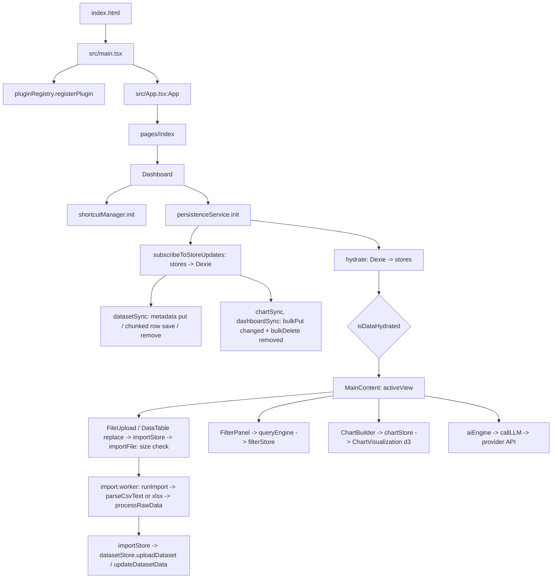

# Flow

## Entry points
- **Browser:** `index.html` loads `src/main.tsx` (in production: `assets/index-*.js`, plus `vendor-react`, `engine-core`, `vendor-viz`, `vendor-export`, `vendor-dates` chunks via modulepreload).
- **Import worker:** `src/features/upload/worker/import.worker.ts`, started by `src/features/upload/lib/importClient.ts:createImportWorker` (`new Worker(new URL(...), { type: "module" })`) once per import and terminated when it ends or is cancelled. In production it is its own IIFE bundle, `assets/import.worker-*.js`.
- **Routes** (`src/App.tsx`, `BrowserRouter basename={import.meta.env.BASE_URL}`):
  - `/` → `src/pages/Index.tsx` → `src/features/dashboard/components/Dashboard.tsx:Dashboard`
  - `*` → `src/pages/NotFound.tsx`
- **CLI scripts** (`package.json`): `dev` (vite), `build`, `preview`, `lint`, `typecheck` (`tsc --noEmit -p tsconfig.app.json`), `test` (vitest), `test:e2e` (playwright, dev server on :8080; specs in `tests/e2e/`, shared setup in `tests/e2e/helpers.ts`), `golden:regen` (`python3 scripts/golden/generate_hr_golden.py`: pandas oracle, reads `tests/fixtures/hr-attrition.csv`, writes `tests/fixtures/hr-attrition.golden.json`; needs `scripts/golden/requirements.txt`), `golden:regen-messy` (`python3 scripts/golden/generate_messy_golden.py`: reads `tests/fixtures/messy/*.csv`, writes `tests/fixtures/messy/messy.golden.json`, numeric stats and date stats), `test:tz` (vitest on `*.tz.test.ts` + `golden.messy` under `TZ=Asia/Kolkata`, `America/New_York`, `UTC`; stops at the first failing zone), `test:bigfiles` (local only, not in CI: `scripts/bigfiles/run.mjs` runs `tests/bigfiles/bigfiles.spec.ts` with `playwright.bigfiles.config.ts` once per file found in `test-data-local/`, one at a time, each with its own dev server; writes `test-results/bigfiles/<file>.json`).
- **CI:** `.github/workflows/deploy.yml` on push to `main`: `npm ci` → lint → typecheck → test (includes the golden suite, no Python needed) → time zone gate (`npm run test:tz`) → install Playwright Chromium → e2e gate (`npm run test:e2e`) → build → production smoke gate (`playwright.prod.config.ts`: `vite preview` on :4173, `tests/smoke/prod-boot.spec.ts` asserts app shell renders with zero page/console errors, then imports a small CSV through the import worker) → upload `dist` → deploy to GitHub Pages.
- No backend, no background jobs.

## Startup order
1. Module evaluation: `vendor-react` (react, react-dom, zustand, react-router), then `engine-core` (`src/shared/services/*`, dexie, and the Zustand stores they import, e.g. `src/store/uiStore.ts` creates `useUiStore` at module load).
2. `src/main.tsx`: `pluginRegistry.registerPlugin(sampleGaugePlugin)` (`src/shared/services/pluginRegistry.ts`, `src/plugins/sampleGaugePlugin`).
3. `createRoot(#root).render(<ThemeProvider><App/></ThemeProvider>)`.
4. `src/App.tsx:App`: ErrorBoundary → QueryClientProvider → TooltipProvider → Toasters → Router.
5. `Dashboard` mount effects:
   - `src/features/workspace/services/shortcutManager.ts:init` (Cmd+K search, undo/redo, etc.)
   - `src/shared/services/persistenceService.ts:init` → `hydrate()` (reads Dexie tables from `src/shared/lib/db.ts` into stores, sets `uiStore.isDataHydrated`; 4s timeout fallback), `subscribeToStoreUpdates()` (writes store changes back to IndexedDB) and `flushOnPageHide()` (`pagehide` / `visibilitychange` hidden → `flush()`). Opening the database runs `db.ts:upgradeToV2` once for a v1 database (see Persistence below).
6. Until `isDataHydrated` is true, `Dashboard` renders a loading state; then it renders `Sidebar` + `src/app/layout/MainContent.tsx:MainContent` for the `uiStore.activeView`.
   - `MainContent` scrolls `#main-content` and the window to the top whenever `uiStore.activeView` changes (any source). `Sidebar`'s mobile section menu (below `lg`) closes on the same `activeView` change, on Esc, on a pointerdown outside the sidebar, and on dataset/dashboard selection.

## Main call graph
- `Dashboard.tsx:Dashboard` → views: `features/upload/components/FileUpload`, `features/datasets/components/DataTable`, `features/filters/components/FilterPanel`, `features/charts/components/ChartBuilder` / `ChartGrid`, `features/export/components/ExportPanel`, lazy `features/pivot/components/PivotExplorer`, `features/stats/components/StatsExplorer`, `features/window/components/WindowExplorer`.
- Import (every file input): `FileUpload` (`<input type="file">` and drop zone) → `src/store/importStore.ts:importForUpload`; `DataTable` "replace data" `<input type="file">` → `importStore.ts:importForReplace`. Both → `importStore.ts:run` → `src/features/upload/lib/importClient.ts:importFile` → `lib/importLimits.ts:checkImportFile` (format + `MAX_IMPORT_BYTES`, before any read; rejection = toast, no dialog; large-file warning toast) → worker `src/features/upload/worker/import.worker.ts` → `lib/importCore.ts:runImport`:
  - CSV/TSV: `readText` (4 MB slices, "reading" %) → `src/shared/services/csvParse.ts:parseCsvText` with `chunkSize` (Papa string chunks → `CsvRecordBuilder.addChunk` → `parsingService.ts:normalizeHeaders`; "parsing" %) → `summarizeIssues` → if rows have problems: worker posts `review`, `ImportDialog` shows the summary, the answer (keep / exclude / cancel) comes back via `importStore.answerReview`.
  - XLSX/XLS: `readBytes` → `src/features/upload/lib/xlsxDates.ts:readWorkbookWithCalendarDates` (date-formatted serials → calendar strings, 1904 system aware) → `planSheet` per sheet (name, used-range row count, `sheet_to_json` keys) → more than one sheet: worker posts `sheets`, `ImportDialog` `SheetPicker` answers via `importStore.answerSheet` (one sheet, or append with `Source sheet`) → `sheetRecords` (`sheet_to_json` in 20,000-row blocks, "parsing" %).
  - Then `src/shared/services/parsingService.ts:processRawData` (`onProgress` → "analysing" %; `importIssues` → `metadata.importIssues`, `parsingStatistics.errorCount`; `cleanValue` with `utils/numeric.ts:trimAscii`, `parseStrictNumber`; `inferColumn` → `utils/dates.ts:analyzeDateColumn` (per-column day/month order, default passed in from the main thread's `localeDayFirst`) → `parseDateValue` for date cells; `generateDatasetMetadata` sets `invalidDateCount`, `dayFirst`, `detectedFormat`, `dateParserVersion`; keeps `dataset.dateSourceValues` for numeric D/M columns) → worker posts `done` (structured clone) → `importClient` terminates the worker.
  - Upload: `importStore` sets stage "saving" (Cancel disabled) → `src/store/datasetStore.ts:uploadDataset` → `persistenceService` subscriber → Dexie. Replace: `DataTable` opens `DatasetUpdateModal` → `datasetStore.updateDatasetData` (with the new `dateSourceValues`).
  - Cancel: `ImportDialog` → `importStore.cancel` → `ImportJob.cancel` → `worker.terminate()`; `datasetStore` is never touched.
  - Progress, sheet picker and parse summary: `src/features/upload/components/ImportDialog.tsx:ImportDialog` (mounted once in `Dashboard`, reads `importStore`). Reopen later: `DataTable` notice → `ImportDialog.tsx:ImportIssuesDialog` (reads `metadata.importIssues`).
- Dates: every reader of stored date cells goes through `src/shared/utils/dates.ts` (calendar parts, no time zone): `queryEngine.ts` (`periodKey` for group-by periods, `calendarDay`/`rangeBoundDay` for `applyFilters` date ranges, `toComparableNumber` + whole-day end bound for `between`/`equals` conditions from `GlobalFilterBar`, `compareCells` in `applySorting`), `window/partitioner.ts:sortPartitionItems` (`compareCells`), `kpi/kpiEngine.ts` trend (via `queryEngine.execute` group-by period), `charts/lib/chartAggregation.ts` (`sortAxisKeys`, `lineSeries` → `dateKeyMs`), `ChartVisualization` (d3 `scaleUtc`/`utcFormat`), `forecasting/engine.ts` (`stepDateKey`), `formula/library/date.ts`, `formulaEngine.ts` (calculated column typing via `isStoredDate`). Day/month toggle: `DataTable` date badge popover → `datasetStore.setDateDayFirst` → `parsingService.ts:reparseDateColumn` (via `applyActiveDatasetUpdate`). Old datasets: `parsingService.ts:needsDateReimportNotice` → `DataTable` notice → `datasetStore.dismissDateReimportNotice`.
- Numbers: every aggregation converts cells with `src/shared/utils/numeric.ts:toNumberOrNull` and reduces with its `minMax`/`sum`/`mean`/`median`/`sampleStdDev`. `queryEngine.ts:aggregateRows` (+ `numericColumnSet(dataset)` for `count`) serves `computeAggregations`, `applyGroupingAndAggregations`, `kpi/kpiEngine.ts` (via `queryEngine.execute`), `pivot/hierarchyBuilder.ts:computeNodeValues` and `charts/lib/chartAggregation.ts:aggregateValues`. `stats/columnSummary.ts:summarizeNumericColumns` serves `DashboardSummary` (Overview), `DataTable` column stats and `exportUtils.ts` PDF summary. `stats/descriptive.ts`, `outliers.ts`, `correlation.ts`, `window/functions.ts`, `aggregations/core.ts`, `ai/anomalyDetector.ts`, `forecasting/engine.ts` call `toNumberOrNull` directly.
- Persistence (`src/shared/services/persistenceService.ts`, schema in `src/shared/lib/db.ts`):
  - Tables (Dexie v2): `datasets` (`StoredDataset`: a dataset without `data`/`dateSourceValues`, plus `rowCount`, `chunkCount`, `dateSourceColumns`), `datasetRows` (key `[datasetId+index]`, `ROW_CHUNK_SIZE` rows per record plus the same slice of `dateSourceValues`), `charts` (no rows), `filters`, `uiState`, `dashboards`.
  - Load: `hydrate` → `loadDatasets` (`db.datasets.toArray`, then per dataset one read transaction with one `datasetRows.get` per chunk → `db.ts:fromStoredDataset`) → `isValidDataset` → `backfillAllIntegerValues` → `formulaEngine.evaluateCalculatedFields` → `windowEngine.evaluate` → stores; then `datasetSync.seed`, `chartSync.seed`, `dashboardSync.seed`, `seedBaselines`.
  - Datasets: `useDatasetStore.subscribe((state, prev))` → `createDatasetSync().onChange(next, prev)`: removed id → `remove` (metadata + chunk range, one transaction); `rowsRevision` differs from disk/queued → dirty, `ROW_SAVE_DELAY_MS` (500 ms) debounce → `saveRows` (one rw transaction: `datasetRows.put(toRowChunk(d, i))` per chunk, delete chunks past the end, `datasets.put(toStoredDataset(d))`); otherwise → `saveMetadata` (`datasets.put`, skipped while a row save is waiting). All dataset jobs run on one queue. `rowsRevision` is bumped by `datasetStore.ts:withNewRows` in `updateDatasetData` and `applyActiveDatasetUpdate` (calculated/window add/delete, `setDateDayFirst`), not by `setColumnTypeOverride` (`changesRows: false`), rename, delete or `dismissDateReimportNotice`.
  - Charts / dashboards: `createRecordSync` (300 ms debounce) → one transaction with `bulkDelete` (ids gone since the last write) + `bulkPut` (objects that changed).
  - Active dataset change → `onActiveDatasetChange` (uiState `activeDatasetId`, dashboard de-select, `restorePivotConfig`, saved filters → `queryEngine.execute`).
  - Failures → `reportSyncFailure` (toast; `QuotaExceededError` gets the "Storage full: changes not saved" message). `whenIdle()` flushes and waits for every write (tests).
- Filters: `FilterPanel` → `src/shared/services/queryEngine.ts` → `src/store/filterStore.ts:setFiltersChange` → charts/table re-render.
- Charts: `ChartBuilder` → `src/store/chartStore.ts` → `features/charts/components/ChartGrid.tsx` / `features/dashboards/components/DashboardGrid.tsx` → `features/charts/components/ChartVisualization.tsx` (d3). A `ChartConfig` holds no rows: `ChartVisualization` derives them from the active dataset (`queryEngine.execute` with the active filters, global filters and drill state) and passes them to `ai/anomalyDetector.ts:detectChartAnomalies(chart, rows)` and plugin charts; `dashboardStore.generateExecutiveSummary` passes `filterStore.filteredData` to `summaryEngine.generateExecutiveSummary` → `detectDashboardAnomalies(charts, rows)`. `ChartVisualization` calls `src/features/charts/lib/chartAggregation.ts`: `aggregateValues` (per-x reduction, delegates to `queryEngine.ts:aggregateRows`), `chartYValueLabel` (Y axis / `<title>` tooltip / sr summary text) and `sortAxisKeys` (bar and heatmap key order). Both grids render `features/charts/components/ChartExpandButton.tsx`, which opens a Radix dialog mounting a second `ChartVisualization` with `fitHeight` (redrawn at the modal's measured size).
- Icon-only controls: wrapped in `src/shared/components/Hint.tsx:Hint` (Radix tooltip + aria-label; shortcut text via `src/shared/lib/platform.ts:formatShortcut`; adds the `hit-area` class from `src/index.css` for the 24px/44px pointer target; renders a `disabled` child as `aria-disabled` with `disabledReason` in the tooltip).
- View list: `src/store/viewTypes.ts:VIEW_TYPES` is the single source for `ViewType` and for `src/shared/utils/validators.ts:isValidUIState`'s `activeView` check (via `isViewType`).
- AI: `src/features/ai/aiEngine.ts` / `summaryEngine.ts` → `src/features/ai/llmService.ts:callLLM` → provider HTTPS API (Gemini default) using key from `uiStore.llmApiKey`.
- Dashboards: `src/features/dashboards/store/*` (dashboard, drill, snapshot, template, view stores), `features/dashboards/services/templateEngine.ts`, `filterManager.ts`.

## Persistence tests
`src/shared/services/__tests__/persistenceService.writes.test.ts` loads fresh modules per test over fake-indexeddb (`vite.config.ts` `setupFiles: ["fake-indexeddb/auto"]`), seeds the database with `src/test/fakeDb.ts:seedDataset`, runs `hydrate` + `subscribeToStoreUpdates`, spies on the Dexie tables and asserts what each store action writes (`whenIdle()` instead of timers). `src/shared/lib/__tests__/db.migration.test.ts` writes a v1 database with plain Dexie and opens it with `db.ts`. Local bench: `scripts/bench/vitest.config.ts` + `scripts/bench/persistence.bench.ts` (1M × 8 rows; not in `npm test` or CI). `tests/e2e/persistence.spec.ts`: import, 2 charts, rename, wait for IndexedDB, reload, check the bars.

## Golden numeric tests
`src/shared/services/__tests__/golden.hrAttrition.test.ts`: `csvParse.ts:parseCsvText` (same path as `FileUpload`) → `parsingService.ts:processRawData` → `queryEngine.execute` (group-by Age / Department / JobRole), `pivot/engine.ts:pivotEngine.execute` (Department > JobRole; Department × Gender with totals), `stats/engine.ts:statsEngine.calculateDatasetStats` (descriptive, IQR/z-score outliers, Pearson), `window/engine.ts:windowEngine.execute` (ROW_NUMBER/RANK/DENSE_RANK/RUNNING_TOTAL) → compared with `tests/fixtures/hr-attrition.golden.json`. `src/features/charts/lib/__tests__/chartAggregation.test.ts` checks the chart's own reduction (`aggregateValues`) against the same file. `tests/e2e/chart-labels.spec.ts` uploads the CSV in the browser and checks the rendered Age × Education bar chart (label, tick order, Age 35 tooltip), inline and in the Expand modal.

`src/shared/services/__tests__/golden.messy.test.ts`: each `tests/fixtures/messy/*.csv` → `parseCsvText` → `processRawData` → `statsEngine.calculateDatasetStats` (full and filtered path), `queryEngine.execute` (the KPI query, and a group-by), chart `aggregateValues`, `summarizeNumericColumns` (Overview) → compared with each other and with `tests/fixtures/messy/messy.golden.json`. Date columns (Netflix `date_added`, Play Store `Last Updated`, Cafe `Transaction Date`): type, `invalidDateCount`, missing count, earliest/latest and `queryEngine` year buckets → compared with the file's `dateStats`.

## Import tests
`src/features/upload/lib/__tests__/importCore.test.ts` runs `runImport` in Node (no worker): a generated 200k-row CSV (row count, types, progress stages in order), the Play Store fixture's short row (keep / exclude, Rating max 19 / 5), XLSX single sheet (same result as the old `sheet_to_json` path), picker, append, and xlsxDates. `importClient.test.ts` drives `importFile` with a fake worker (cancel terminates, size cap before any read or worker). `tests/e2e/import.spec.ts`: size cap on each input with a fake 150.8 MB `File`, parse summary on `tests/fixtures/messy/playstore.csv`, multi-sheet picker and append with a workbook generated in the test, cancel with a generated CSV.

## Time zone tests
`npm run test:tz` runs `src/shared/utils/__tests__/dates.tz.test.ts`, `src/shared/services/__tests__/dates.ingest.tz.test.ts`, `src/features/charts/lib/__tests__/lineSeries.tz.test.ts`, `src/features/upload/lib/__tests__/xlsxDates.tz.test.ts` and `golden.messy.test.ts` once per zone. `tests/e2e/dates.spec.ts` runs the line-gap and day/month toggle paths in an en-IN / Asia/Kolkata browser.

## Build chunking note
`vite.config.ts` `manualChunks` must not create static cycles between chunks. Rollup's `\0commonjsHelpers.js` is pinned to `vendor-react` so `vendor-react` has no imports; see `decisions.md`.
